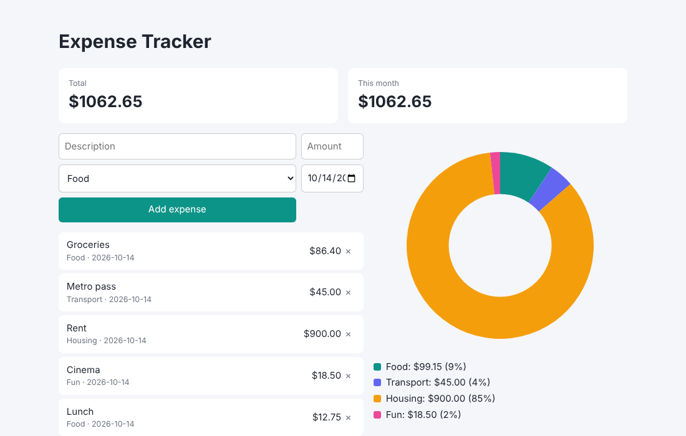

# Expense Tracker

 

**[▶ Live demo](https://showa21.github.io/expense-tracker/)**

A personal finance dashboard in vanilla JavaScript with a hand-drawn **Canvas donut chart**.

- Add/delete expenses with category and date; data persists in `localStorage`
- Running total, current-month total, per-category breakdown with legend
- Money maths is rounded to cents to avoid floating-point drift (unit-tested in `calc.js`)
- Responsive, accessible labels, automatic dark mode

## Run / test
Open `index.html` in a browser. Tests: `npm test`.
